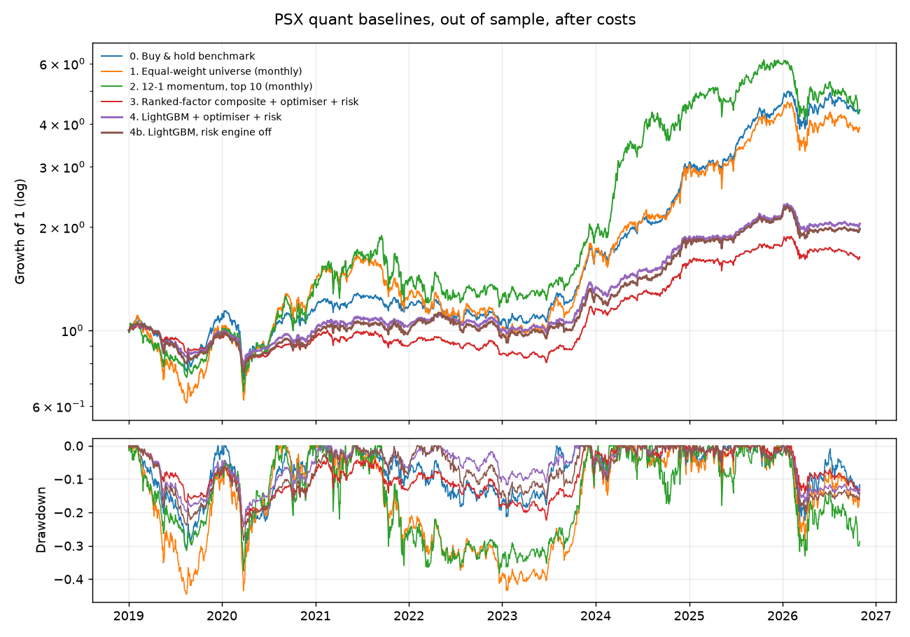

# Results: PSX quant baselines

Test period **2019-01-02 to 2026-10-30** (walk-forward, out of sample), the 60 most liquid PSX stocks each day (point-in-time, delisted names included), daily bars, orders filled at the next open. Benchmark: the KSE-100 index. Costs: 17 bps commission and fees + 20 bps slippage per side + square-root impact (k=0.2). Sharpe ratios use a zero risk-free rate. 95% Sharpe CIs from a stationary block bootstrap (mean block 20 days).

| Strategy | CAGR | Vol | Sharpe [95% CI] | Max DD | Calmar | Beta | Avg gross | Turnover/yr | Cost drag/yr | PSR |
|---|---|---|---|---|---|---|---|---|---|---|
| 0. Buy & hold benchmark | 21.2% | 20.0% | 1.06 [0.21, 1.97] | 37.0% | 0.57 | 1.00 | 99.9% | 0.1x | 0.0% | 1.00 |
| 1. Equal-weight universe (monthly) | 19.3% | 26.1% | 0.81 [-0.03, 1.70] | 44.6% | 0.43 | 1.21 | 98.6% | 1.0x | 0.8% | 0.99 |
| 2. 12-1 momentum, top 10 (monthly) | 21.2% | 29.2% | 0.80 [0.03, 1.62] | 38.2% | 0.55 | 1.12 | 99.6% | 3.3x | 2.3% | 0.99 |
| 3. Ranked-factor composite + optimiser + risk | 6.5% | 10.8% | 0.64 [-0.23, 1.57] | 24.3% | 0.27 | 0.48 | 53.9% | 11.3x | 8.6% | 0.96 |
| 4. LightGBM + optimiser + risk | 9.8% | 11.0% | 0.90 [0.00, 1.84] | 24.2% | 0.40 | 0.49 | 54.0% | 8.6x | 6.4% | 0.99 |
| 4b. LightGBM, risk engine off | 9.3% | 13.0% | 0.75 [-0.11, 1.65] | 28.4% | 0.33 | 0.58 | 65.2% | 10.1x | 7.4% | 0.98 |

## Statistical tests

- Deflated Sharpe ratio of 4. LightGBM + optimiser + risk (5 trials): **0.985**
- p-value, Sharpe(3. Ranked-factor composite + optimiser + risk) > Sharpe(0. Buy & hold benchmark): **0.985**
- p-value, Sharpe(3. Ranked-factor composite + optimiser + risk) > Sharpe(1. Equal-weight universe (monthly)): **0.774**
- p-value, Sharpe(4. LightGBM + optimiser + risk) > Sharpe(3. Ranked-factor composite + optimiser + risk): **0.075**
- p-value, Sharpe(4. LightGBM + optimiser + risk) > Sharpe(4b. LightGBM, risk engine off): **0.021**

## Signal quality (rebalance dates, 10-day forward excess return)

| Signal | Mean IC | IC t-stat | IC > 0 | Q1 -> Q5 forward excess (bps) |
|---|---|---|---|---|
| Factor composite | 0.064 | 5.32 | 60.0% | +2 / -5 / +0 / -11 / +14 |
| LightGBM | 0.071 | 6.28 | 61.6% | -22 / -22 / -20 / +15 / +49 |

## Cost stress test (2x costs)

| Strategy | Sharpe at 1x | Sharpe at 2x | CAGR at 2x |
|---|---|---|---|
| 3. Ranked-factor composite + optimiser + risk | 0.64 | -0.14 | -2.1% |
| 4. LightGBM + optimiser + risk | 0.90 | 0.33 | 3.0% |

## Sharpe by calendar year

| | 2019 | 2020 | 2021 | 2022 | 2023 | 2024 | 2025 | 2026 |
|---|---|---|---|---|---|---|---|---|
| 0. Buy & hold benchmark | 0.49 | 0.42 | 0.20 | -0.57 | 2.73 | 3.52 | 2.15 | -0.04 |
| 1. Equal-weight universe (monthly) | 0.10 | 1.26 | -0.31 | -0.84 | 2.52 | 2.76 | 1.62 | -0.21 |
| 2. 12-1 momentum, top 10 (monthly) | -0.03 | 1.29 | 0.17 | -0.37 | 2.21 | 3.00 | 1.31 | -0.99 |
| 3. Ranked-factor composite + optimiser + risk | -0.58 | 0.14 | -0.47 | -0.70 | 2.93 | 3.02 | 1.25 | -0.68 |
| 4. LightGBM + optimiser + risk | -0.24 | 0.28 | 0.38 | -0.39 | 2.67 | 3.12 | 1.57 | -0.49 |
| 4b. LightGBM, risk engine off | -0.29 | 0.14 | 0.27 | -0.20 | 2.02 | 3.06 | 1.57 | -0.58 |

## LightGBM walk-forward

- Retrained 30 times (every 63 sessions) on labels already revealed at each retrain date; hyperparameters chosen by purged, embargoed CV.
- Last retrain 2026-07-31: 156,521 rows, params {'num_leaves': 7, 'max_depth': 3, 'learning_rate': 0.03, 'n_estimators': 300, 'min_child_samples': 200}, CV IC per grid point [0.078, 0.0779, 0.0769].
- Top features at last retrain (gain): mkt_vol_21, mkt_ret_21, vol_63, park_vol_21, ma_20_50.

## Reading these results honestly

- **Survivorship bias:** the universe is rebuilt every day from data known that day and includes stocks that were later delisted, so there is no survivorship bias from today's index membership. Sectors come from today's symbol list, so delisted stocks are tagged 'Unknown'.
- **Trials:** the deflated Sharpe ratio counts all 5 distinct non-benchmark configurations ever run (from the run registry in `data/state.sqlite`), including runs replaced after bug fixes. See `reports/experiment_log.md`.
- **Fundamentals:** PSX fundamentals come from results PDFs (OCR + rules, LLM fallback). Extraction has so far run on a sample of 2026 reports only, so this run uses price and liquidity features; the next run adds earnings yield and sales-to-price once the full report history is processed.

