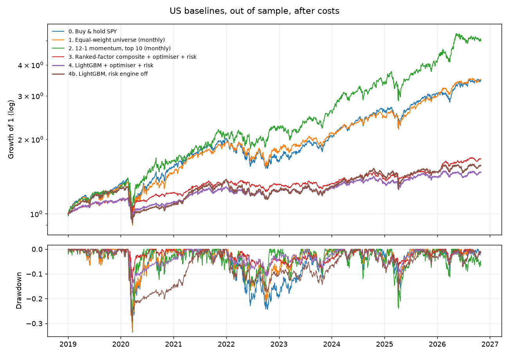

# Milestone 1 results: US quant baselines

Test period **2019-01-02 to 2026-10-29** (walk-forward, out of sample), 40 US large caps, daily bars, orders filled at the next open. Costs: 5 bps slippage per side + square-root impact (k=0.1). Sharpe ratios use a zero risk-free rate. 95% Sharpe CIs from a stationary block bootstrap (mean block 20 days).

| Strategy | CAGR | Vol | Sharpe [95% CI] | Max DD | Calmar | Beta | Avg gross | Turnover/yr | Cost drag/yr | PSR |
|---|---|---|---|---|---|---|---|---|---|---|
| 0. Buy & hold SPY | 17.2% | 19.1% | 0.93 [0.26, 1.68] | 33.5% | 0.51 | 0.99 | 99.5% | 0.1x | 0.0% | 0.99 |
| 1. Equal-weight universe (monthly) | 17.4% | 17.7% | 1.00 [0.32, 1.82] | 33.1% | 0.53 | 0.87 | 98.0% | 0.2x | 0.0% | 1.00 |
| 2. 12-1 momentum, top 10 (monthly) | 22.9% | 22.0% | 1.05 [0.45, 1.66] | 29.7% | 0.77 | 0.97 | 99.7% | 2.8x | 0.3% | 1.00 |
| 3. Ranked-factor composite + optimiser + risk | 6.7% | 8.6% | 0.80 [0.21, 1.51] | 13.6% | 0.49 | 0.34 | 65.5% | 10.1x | 1.0% | 0.99 |
| 4. LightGBM + optimiser + risk | 5.1% | 9.0% | 0.60 [-0.04, 1.34] | 17.9% | 0.28 | 0.39 | 64.9% | 10.0x | 1.0% | 0.95 |
| 4b. LightGBM, risk engine off | 5.9% | 12.7% | 0.52 [-0.19, 1.36] | 28.8% | 0.21 | 0.55 | 84.9% | 12.6x | 1.3% | 0.92 |

## Statistical tests

- Deflated Sharpe ratio of 4. LightGBM + optimiser + risk (6 trials): **0.793**
- p-value, Sharpe(3. Ranked-factor composite + optimiser + risk) > Sharpe(0. Buy & hold SPY): **0.688**
- p-value, Sharpe(3. Ranked-factor composite + optimiser + risk) > Sharpe(1. Equal-weight universe (monthly)): **0.780**
- p-value, Sharpe(4. LightGBM + optimiser + risk) > Sharpe(3. Ranked-factor composite + optimiser + risk): **0.855**
- p-value, Sharpe(4. LightGBM + optimiser + risk) > Sharpe(4b. LightGBM, risk engine off): **0.203**

## Signal quality (rebalance dates, 10-day forward excess return)

| Signal | Mean IC | IC t-stat | IC > 0 | Q1 -> Q5 forward excess (bps) |
|---|---|---|---|---|
| Factor composite | 0.006 | 0.38 | 54.5% | +16 / -10 / +0 / +1 / -7 |
| LightGBM | 0.013 | 1.20 | 49.6% | +4 / -2 / -16 / -13 / +27 |

## Cost stress test (2x costs)

| Strategy | Sharpe at 1x | Sharpe at 2x | CAGR at 2x |
|---|---|---|---|
| 3. Ranked-factor composite + optimiser + risk | 0.80 | 0.68 | 5.7% |
| 4. LightGBM + optimiser + risk | 0.60 | 0.48 | 4.0% |

## Sharpe by calendar year

| | 2019 | 2020 | 2021 | 2022 | 2023 | 2024 | 2025 | 2026 |
|---|---|---|---|---|---|---|---|---|
| 0. Buy & hold SPY | 2.31 | 0.67 | 2.01 | -0.71 | 1.86 | 1.83 | 0.94 | 1.27 |
| 1. Equal-weight universe (monthly) | 2.37 | 0.53 | 2.38 | -0.29 | 1.53 | 1.51 | 1.29 | 2.03 |
| 2. 12-1 momentum, top 10 (monthly) | 2.16 | 0.86 | 1.32 | 0.49 | 1.04 | 1.51 | 0.95 | 1.31 |
| 3. Ranked-factor composite + optimiser + risk | 2.21 | 0.55 | 1.50 | -0.51 | 0.16 | 0.63 | 0.83 | 2.08 |
| 4. LightGBM + optimiser + risk | 2.12 | -0.09 | 1.83 | -0.37 | 0.44 | 0.61 | 0.65 | 0.75 |
| 4b. LightGBM, risk engine off | 2.52 | -0.58 | 2.20 | -0.72 | 0.48 | 1.04 | 0.36 | 0.81 |

## LightGBM walk-forward

- Retrained 31 times (every 63 sessions) on labels already revealed at each retrain date; hyperparameters chosen by purged, embargoed CV.
- Last retrain 2026-09-25: 127,680 rows, params {'num_leaves': 7, 'max_depth': 3, 'learning_rate': 0.03, 'n_estimators': 300, 'min_child_samples': 200}, CV IC per grid point [0.0329, 0.0302, 0.0302].
- Top features at last retrain (gain): dispersion_21, ma_50_200, mkt_vol_21, log_adv_20, amihud_21.

## Reading these results honestly

- **Survivorship bias:** the universe is today's large caps, so every strategy (including equal weight) benefits from knowing these companies survived. Absolute returns are flattered; comparisons between strategies on the same universe are fairer.
- **Trials:** the deflated Sharpe ratio counts all 6 distinct non-benchmark configurations ever run (from the run registry in `data/state.sqlite`), including runs replaced after bug fixes. See `reports/experiment_log.md`.
- **Fundamentals:** SEC EDGAR fundamentals were not available for this run (EDGAR needs a contact User-Agent in `.env`), so value and quality factors are absent and the composite uses price factors only.

